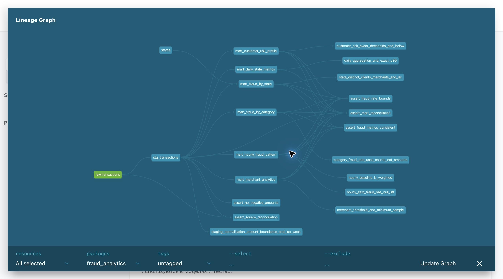

# Домашняя работа по dbt

Данные из teta-ml-1-2025 из домашки по ClickHouse.

Версии: dbt-core 1.10.15, dbt-clickhouse 1.9.8, ClickHouse 25.3.14.14.

## Модели

В stg_transactions приводятся типы, очищаются строки и добавляются сегменты сумм. Дальше данные используются в шести витринах:

- mart_daily_state_metrics: дневные метрики по штатам, средний чек, P95, доля крупных транзакций.
- mart_fraud_by_category: количество и сумма фрода по категориям.
- mart_fraud_by_state: фрод по штатам, уникальные клиенты и мерчанты.
- mart_customer_risk_profile: история клиента и риск HIGH/MEDIUM/LOW.
- mart_hourly_fraud_pattern: фрод по дням недели и часам.
- mart_merchant_analytics: оборот, fraud_rate и подозрительные мерчанты.

Используются dbt_utils, dbt_date, dbt_expectations и свои макросы amount_bucket, fraud_rate, customer_risk. Описания моделей и колонок находятся в YAML.

## Проверки

Прошли 127 проверок данных и 8 unit-тестов.

- Базовые тесты: not_null, unique, accepted_values, relationships, ключи витрин и диапазоны значений.
- SQL-тесты: суммы, fraud_rate и совпадение итогов между слоями.
- Unit-тесты: агрегации, P95, границы сумм и риска, календарные поля и случай без фрода.

[Лог dbt test](evidence/dbt_test.log). SQLFluff настроен в .sqlfluff, pre-commit в .pre-commit-config.yaml.

## DAG



## Запуск

Нужны Python 3.11 или новее, Docker и Make. Из корня репозитория выполнить:

```bash
make install
make up
make load
make all
```

Если данные уже загружены, make load пропустить.

- Другой путь к CSV: make load CSV=/path/to/train.csv.
- Проверки: make test lint.
- Документация: make docs и make serve, затем открыть http://127.0.0.1:8084.
- ClickHouse работает на порту 18124.
